# Sheet Explorer

Une application web qui se connecte à **n'importe quel Google Sheet** à partir de son lien, affiche
les données et permet de les rechercher, filtrer, trier, consulter ligne par ligne, croiser avec une
autre base et exporter en CSV.

L'application ne connaît **rien à l'avance** des colonnes : la première ligne de l'onglet sert
d'en-têtes, et chaque colonne découverte reçoit un numéro de rubrique (`01`, `02`…) qui la suit
partout : tableau, filtres, fiche détail et croisements (`A·06 ⇄ B·01`).


L'application a deux pages :

- **`/`, la landing** : une barre, une hero (titre, actions, vidéo tutoriel de 45 s en 8 étapes :
  partager le Sheet, copier le lien, le coller, chercher, ouvrir une fiche, croiser) et un pied de page. Le bouton **« Connecter un Google Sheet »** Il ouvre le formulaire d'ajout ; dès qu'un lien valide est
  lu (fichier partagé, onglet non vide), la base est enregistrée et le back office s'ouvre.
  « Essayer avec la démo » ouvre le back office avec les 4 bases fictives.
- **`/app`, le back office** : bases, tableau, fiches, croisements, export. Si des bases sont déjà
  enregistrées dans le navigateur, la landing propose « Ouvrir mes bases » sans redemander de lien.
  Les bases de démonstration sont rangées à part (« Démonstration ») et se retirent d'un clic.

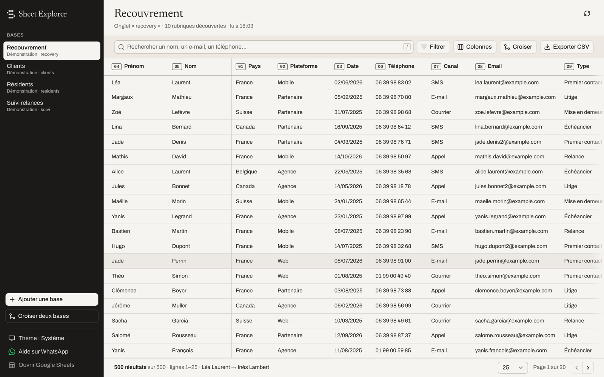

## Sommaire

1. [Fonctionnalités](#fonctionnalités)
2. [Installation](#installation)
3. [Créer la clé d'API Google](#créer-la-clé-dapi-google)
4. [Partager un Google Sheet](#partager-un-google-sheet)
5. [Importer les données de test](#importer-les-données-de-test)
6. [Captures](#captures)
7. [Architecture](#architecture)
8. [Scripts](#scripts)

## Fonctionnalités

| Fonctionnalité | Détail |
| --- | --- |
| Ajouter une base | Coller le lien d'un Sheet et lui donner un nom. L'ID est extrait du lien (`/spreadsheets/d/{ID}/`), les onglets sont listés (l'onglet du lien `#gid=` est présélectionné), et l'onglet est lu **avant** l'enregistrement : lien invalide, fichier non partagé ou onglet vide sont signalés tout de suite. |
| Connexions sauvegardées | Bases et croisements sont gardés dans le navigateur (`localStorage`). Barre latérale pour basculer, renommer, supprimer (avec « Annuler »). |
| Vue tableau | En-têtes = première ligne. Recherche globale sur toutes les colonnes, insensible aux accents et aux majuscules (« elodie » trouve « Élodie », « +33639981234 » trouve « 06 39 98 12 34 »). |
| Filtres par colonne | Texte : contient, est égal à, est vide, n'est pas vide. Nombres et dates **détectés automatiquement** : plage min / max. Plusieurs filtres se cumulent. |
| Tri, pagination, colonnes | Tri typé (nombres, dates `JJ/MM/AAAA` ou `AAAA-MM-JJ`, texte à la française), 25 / 50 / 100 lignes par page, choix des colonnes visibles, compteur « X résultats sur Y ». |
| Fiche détail | Clic sur une ligne : tous les champs en cases numérotées, liens `mailto:` / `tel:`, copie d'une valeur, fiche précédente / suivante (↑ ↓), fermeture par Échap. |
| Croiser deux bases | Base A, base B, colonne clé de chacune (les noms peuvent différer : « Téléphone » / « phone »). Clés normalisées : espaces, casse, points et tirets ignorés ; téléphones comparés sur leurs **9 derniers chiffres**. Intersection, Tout A ou Différence (dans A, pas dans B). Un aperçu montre le nombre de correspondances et un exemple de rapprochement avant validation. |
| Résultat du croisement | Même vue que les bases (recherche, filtres, tri, export). Colonnes préfixées `A.` / `B.`, colonne « Clé comparée », tampon « Trouvé dans B » / « Absent de B » en mode Tout A. |
| Export CSV | Le résultat filtré et trié, colonnes visibles uniquement, encodé UTF-8 avec BOM (s'ouvre correctement dans Excel). |
| Interface | En français, clair / sombre / système, responsive (fiche en panneau fixe sur grand écran, en tiroir ailleurs). |

Raccourcis : `/` pour chercher, `↑` `↓` pour parcourir les fiches, `Échap` pour fermer la fiche.

## Installation

Prérequis : **Node.js 20.9 ou plus récent** et npm.

```bash
git clone <url-du-dépôt> sheet-explorer
cd sheet-explorer
npm install
cp .env.example .env.local
```

Renseignez ensuite `GOOGLE_SHEETS_API_KEY` dans `.env.local` (voir la section suivante) et, si vous
voulez le bouton d'aide, `WHATSAPP_NUMBER`. Puis :

```bash
npm run dev
```

La landing est servie sur <http://localhost:3000> et le back office sur <http://localhost:3000/app>.

> **Sans clé ?** En développement, la landing propose « Essayer avec la démo » (et le back office
> vide, « Charger les 4 bases de démonstration ») : ce sont les CSV de `sample-data/`, servis par le serveur de l'application.
> Pratique pour essayer la jointure tout de suite. Elles sont désactivées en production sauf si
> `SHEETS_DEMO_MODE=true`.

## Créer la clé d'API Google

La clé reste **côté serveur** : le navigateur appelle `/api/sheets`, et c'est la route Next.js qui
interroge l'API Google Sheets v4.

1. Ouvrez la [console Google Cloud](https://console.cloud.google.com/) et connectez-vous.
2. En haut, **Sélectionner un projet → Nouveau projet**. Nommez-le (ex. `sheet-explorer`) et créez-le.
3. Menu **API et services → Bibliothèque**. Cherchez **Google Sheets API**, ouvrez-la et cliquez sur
   **Activer**.
4. Menu **API et services → Identifiants → Créer des identifiants → Clé API**. Copiez la clé.
5. Recommandé : cliquez sur la clé puis, dans **Restrictions relatives aux API**, choisissez
   **Restreindre la clé** et cochez seulement **Google Sheets API**. Enregistrez.
6. Collez la clé dans `.env.local` :

   ```bash
   GOOGLE_SHEETS_API_KEY=AIza...votre-clé
   ```

7. Redémarrez `npm run dev` pour que la variable soit lue.

Messages possibles et leur cause :

| Message dans l'application | Cause |
| --- | --- |
| « Aucune clé d'API n'est configurée » | `GOOGLE_SHEETS_API_KEY` absente de `.env.local`, ou serveur non redémarré. |
| « La clé d'API Google est invalide » | Clé mal copiée ou supprimée. |
| « L'API Google Sheets n'est pas activée » | Étape 3 oubliée (l'activation peut prendre une minute). |
| « Ce fichier n'est pas partagé » | Le Sheet n'est pas accessible avec le lien (voir ci-dessous). |
| « L'onglet … est vide » | L'onglet ne contient aucune cellule ; la première ligne doit porter les en-têtes. |

### Plus tard : compte de service

`lib/sheets-source.ts` définit une interface `SheetsSource` (`getSpreadsheet`, `getValues`). La v1
l'implémente avec `ApiKeySource`. Pour lire des Sheets privés, il suffira d'ajouter une
`ServiceAccountSource` (jeton OAuth du compte de service dans l'en-tête `Authorization`) et de la
retourner depuis `getSheetsSource()` ; le reste de l'application ne change pas.

## Partager un Google Sheet

Avec une clé d'API, Google n'autorise que les fichiers lisibles par lien :

1. Ouvrez le Sheet, cliquez sur **Partager** (en haut à droite).
2. Sous **Accès général**, choisissez **Tous les utilisateurs disposant du lien**.
3. Laissez le rôle sur **Lecteur**, cliquez sur **Copier le lien**, puis sur **OK**.
4. Collez ce lien dans **Connecter un Google Sheet** (landing) ou **Ajouter une base** (back office).
   L'adresse du fichier dans la barre du navigateur (`https://docs.google.com/spreadsheets/d/…/edit#gid=0`)
   fonctionne aussi.

> Un fichier partagé « avec le lien » est lisible par toute personne qui possède ce lien. N'y mettez
> pas de données sensibles réelles pour un TD.

## Importer les données de test

Le dossier `sample-data/` contient 4 fichiers CSV **100 % fictifs** de 500 lignes :

| Fichier | Colonnes |
| --- | --- |
| `recovery.csv` | Pays, Plateforme, Date, Prénom, Nom, Téléphone, Canal, Email, Type, Montant |
| `clients.csv` | phone, Nom, Prenom, Adresse, Ville, Code Postal, Email, Statut logement |
| `residents.csv` | First Name, Last Name, Street Address, City, Province, Postcode, Phone, Age, Language, Household Size |
| `suivi.csv` | Name, Email, Phone, Country, Date, Statut, Commentaire, Date de rappel |

- E-mails en `@example.com`. Téléphones pris dans les plages réservées à la fiction par l'ARCEP
  (`06 39 98 xx xx`, `01 99 00 xx xx`) et les numéros nord-américains fictifs `555-01xx`.
- **75 personnes (15 %) apparaissent dans les 4 fichiers**, avec des écritures volontairement
  différentes : `06 39 98 12 34` (recovery), `+33639981234` (clients), `+33 6 39 98 12 34`
  (residents), `06.39.98.12.34` (suivi), e-mails parfois en majuscules ou entourés d'espaces.
- Pour régénérer les fichiers (graine fixe, résultat identique) : `npm run sample-data`.

Pour les importer :

1. Créez un Google Sheet vide (<https://sheets.new>).
2. **Fichier → Importer → Importer**, déposez `recovery.csv`.
3. Choisissez **Remplacer la feuille de calcul** (ou **Insérer de nouvelles feuilles** pour mettre
   les 4 fichiers dans un même classeur, un onglet chacun), séparateur **Détecter automatiquement**,
   et décochez **Convertir le texte en nombres, dates et formules** pour garder les téléphones tels
   quels (sinon le 0 initial disparaît).
4. Partagez le fichier (section précédente) et ajoutez-le dans l'application.
5. Recommencez pour les autres fichiers, puis **Croiser deux bases** : par exemple
   Recouvrement.`Téléphone` ⇄ Clients.`phone` donne **75 lignes** en intersection.

## Captures

### Landing

| | |
| --- | --- |
|  Hero : titre, actions et vidéo de démonstration | 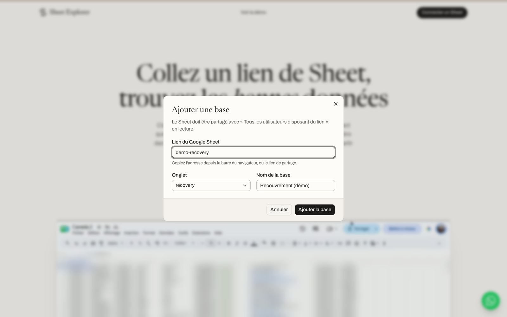 « Connecter un Google Sheet » ouvre le formulaire |
| 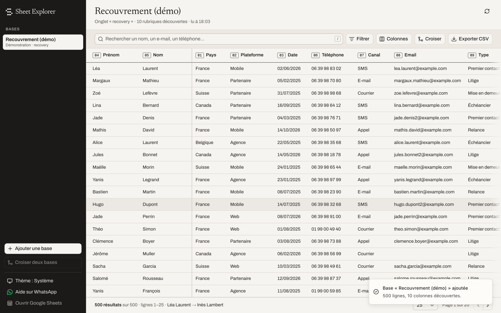 Lien valide : arrivée dans le back office |  Mode sombre |
|  Page entière, jusqu'au pied de page |  Mobile |

### Back office

| | |
| --- | --- |
| 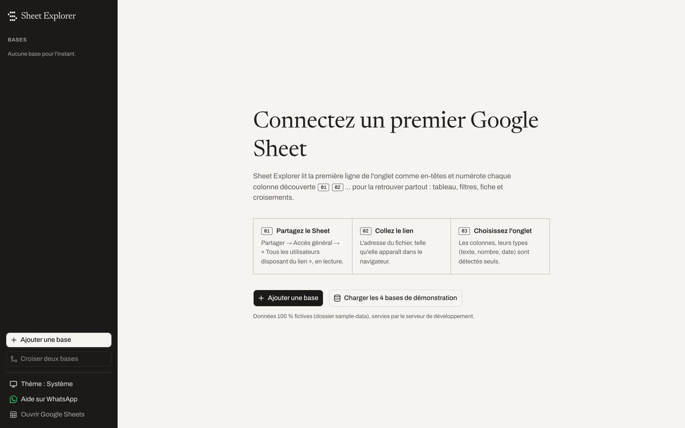 Accueil, sans base connectée | 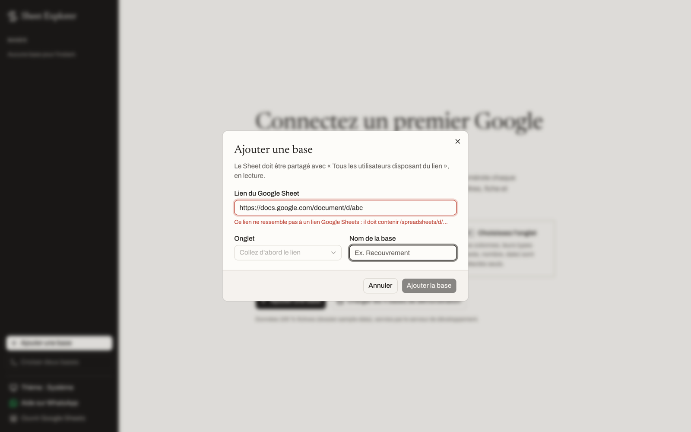 Ajout d'une base : lien invalide |
| 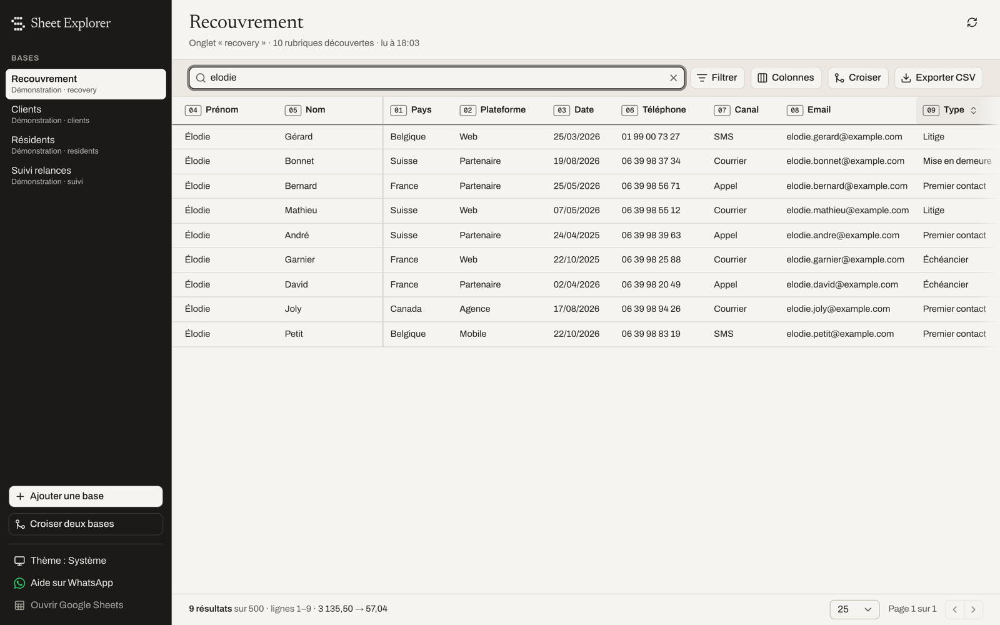 Recherche « elodie » sans accent, tri par montant, mots-repères en pied | 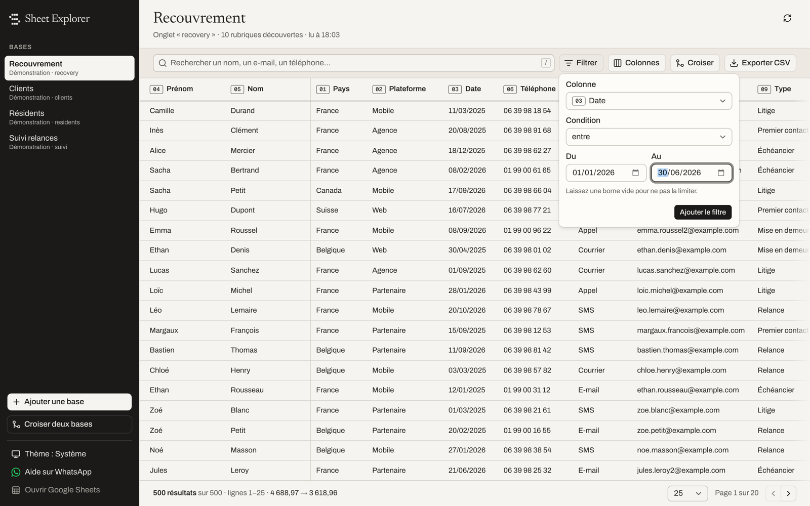 Filtre de plage sur une colonne date détectée |
| 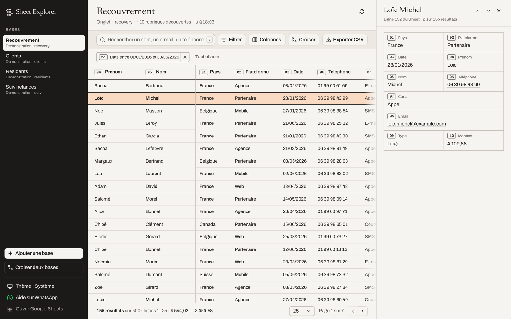 Fiche détail en cases numérotées | 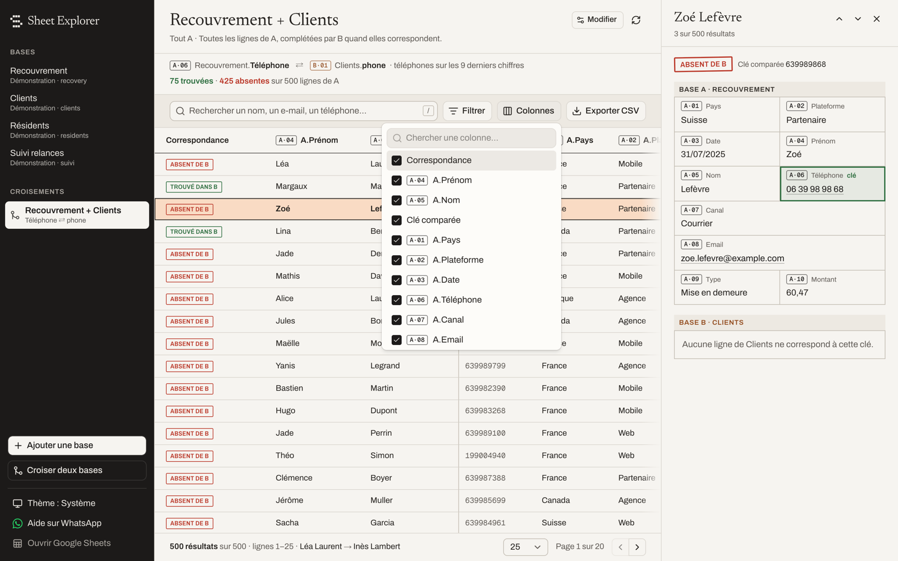 Choix des colonnes visibles |
| 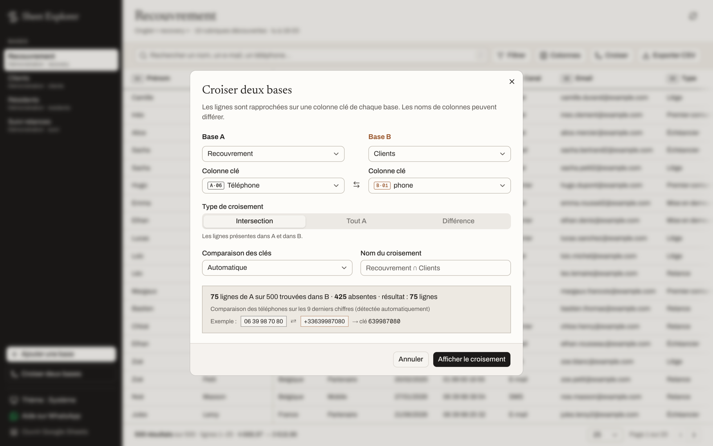 Croisement : aperçu et exemple de rapprochement | 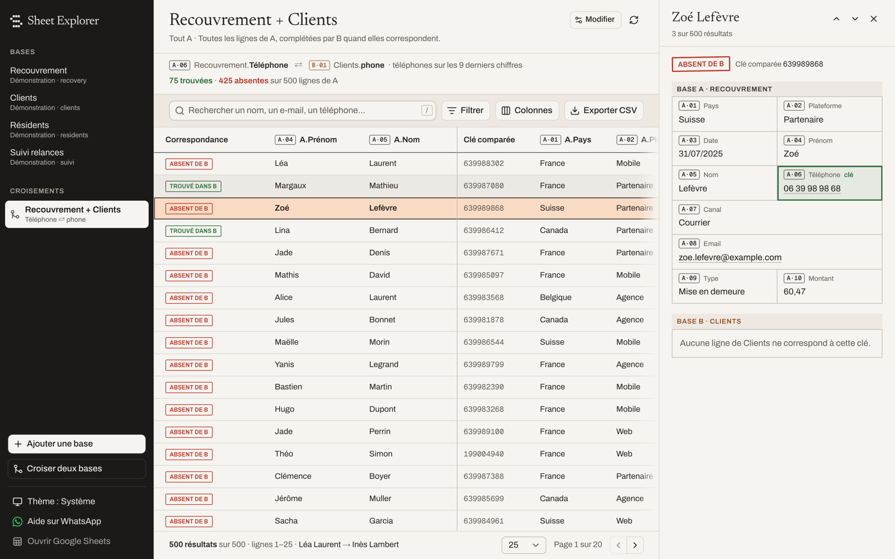 Résultat « Tout A » : tampons et clés mises en évidence |
| 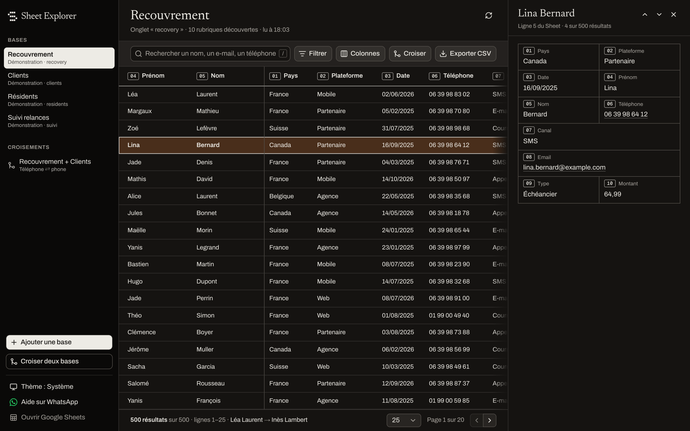 Mode sombre | 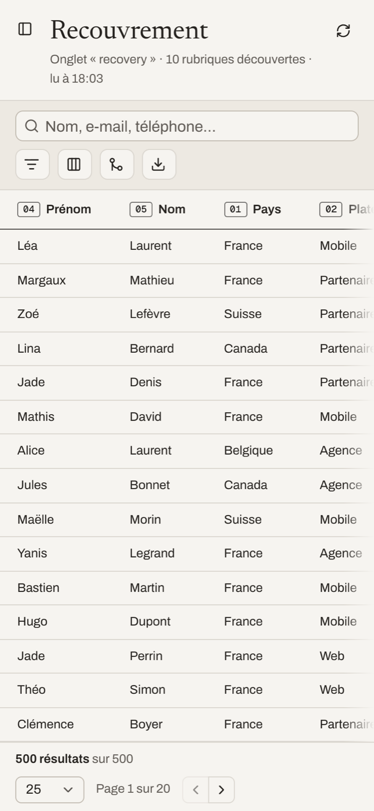 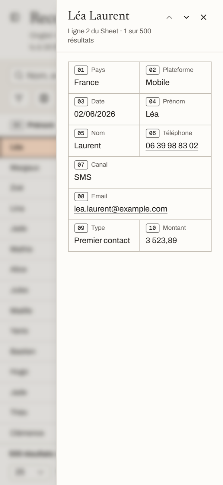 Mobile |

## Architecture

```
app/
  api/sheets/route.ts      Route serveur : onglets et valeurs d'un Sheet (clé API côté serveur)
  layout.tsx               Thème clair/sombre, toasts
  page.tsx                 Landing (/)
  icon.svg                 Icône d'onglet (monogramme)
  app/page.tsx             Back office (/app)
  globals.css              Jetons de couleur (clair et sombre)
components/
  landing/                 Landing : page, vidéo de démo, année du pied, boutons « Connecter un Google Sheet » / démo
  logo.tsx                 Monogramme (« S » en cellules) et nom ; même dessin que app/icon.svg
  whatsapp.tsx             Logo WhatsApp, bouton flottant de la landing
  explorer.tsx             Back office : rail, vue principale, dialogues
  app-sidebar.tsx          Bases et croisements : basculer, renommer, supprimer
  views.tsx                Vue d'une base / vue d'un croisement
  data-view.tsx            Barre d'outils, tableau, pied, fiche
  data-table.tsx           Tableau TanStack (en-têtes numérotés, tri)
  column-filters.tsx       Ajout et édition des filtres
  column-visibility.tsx    Colonnes visibles (Command)
  row-detail.tsx           Fiche détail
  add-source-dialog.tsx    Ajout d'une base
  join-dialog.tsx          Croisement de deux bases avec aperçu
  ui/                      Composants shadcn/ui
hooks/
  use-sources.ts           Connexions en localStorage
  use-sheet-data.ts        Chargement et cache des données
  use-filters.ts           Recherche globale et filtres
  use-data-table.ts        Tri, pagination, visibilité (TanStack Table v9)
  use-join.ts              Calcul d'un croisement
lib/
  sheets-source.ts         Abstraction de source (clé API ; compte de service plus tard ; démo)
  demo.ts                  Liste des bases de démonstration
  fonts.ts                 Newsreader (titres) et Geist Mono (étiquettes, numéros)
  whatsapp.ts              Lien wa.me avec message de salutation (WHATSAPP_NUMBER)
  sheet-url.ts             Extraction de l'ID depuis le lien
  normalize.ts             Accents, téléphones (9 chiffres), clés de jointure
  column-types.ts          Détection nombre / date / texte
  dataset.ts, filters.ts   Jeu de données, index de recherche, filtres
  join.ts                  Intersection, Tout A, Différence
  csv.ts                   Lecture / écriture CSV
scripts/
  generate-sample-data.mjs Génère les CSV fictifs
  test-join.ts             Vérifie normalisation, détection, recherche et jointures
```

Choix techniques :

- **Lecture** : `GET /v4/spreadsheets/{id}?fields=properties.title,sheets.properties(sheetId,title)`
  pour les onglets (le titre du classeur préremplit le nom, `sheetId` permet de présélectionner
  l'onglet du lien), puis `GET /v4/spreadsheets/{id}/values/'{onglet}'` pour les données.
- **Performance** (~20 000 lignes) : filtrage, tri et jointure côté client sur des fonctions pures.
  Le texte de recherche replié et les valeurs numériques sont calculés **une fois** par jeu de
  données, la recherche est différée (`useDeferredValue`) et la jointure passe par un index
  (`Map`). Mesuré par `npm run test:join` sur 20 000 lignes : environ 40 ms pour la recherche
  (index compris) et 20 ms pour la jointure. La pagination limite le rendu à 100 lignes au plus ;
  la virtualisation n'était donc pas nécessaire.
- **TanStack Table v9** (`useTable`, fonctionnalités explicites) : les lignes du tableau sont des
  références vers les données, sans copie.

La vidéo `public/landing/demo.mp4` / `demo.webm` assemble deux sources : l'application pilotée avec
Playwright sur les bases fictives (landing → « Connecter un Google Sheet » → lien collé → recherche →
fiche → croisement) et un enregistrement d'écran du partage dans Google Sheets, dont le tableau et
l'identité du propriétaire sont floutés. Les légendes numérotées sont incrustées.

### Aide WhatsApp

Avec `WHATSAPP_NUMBER` dans `.env.local` (format international, ex. `+33600000000`), la landing
affiche un bouton WhatsApp flottant et le back office une entrée « Aide sur WhatsApp ». La conversation
s'ouvre avec un message de salutation pré-rempli. Sans la variable, rien n'est affiché.

## Scripts

| Commande | Rôle |
| --- | --- |
| `npm run dev` | Serveur de développement |
| `npm run build` / `npm start` | Build et serveur de production |
| `npm run lint` | ESLint |
| `npm run test:join` | Vérifie la normalisation, la détection des types, la recherche et les jointures sur `sample-data/` (75 correspondances attendues pour chaque paire) |
| `npm run sample-data` | Régénère les CSV fictifs |
